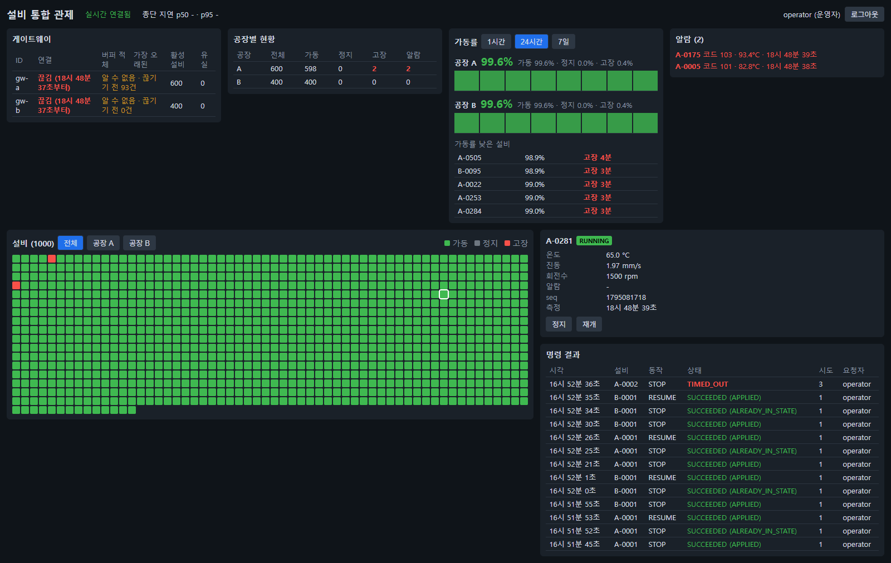

# factory-edge-monitor

폐쇄망 공장 2곳(설비 1,000대)의 엣지 게이트웨이와 중앙 통합 관제.
- 설계 문서: [docs/design.md](docs/design.md) · 자체 점검: [docs/review.md](docs/review.md) · 구조도: [docs/architecture.svg](docs/architecture.svg)



## 결과 요약 (실제 compose 구성에서 측정, 설계 문서 10장)
| 항목 | 결과 |
|---|---|
| 두 회선 10분 단절 → 복구 | **유실 0 · 중복 0** (6회 측정 모두), 적체 해소 66초, 화면 실시간 복귀 10초 |
| 서버·DB·게이트웨이 강제 종료 30초 | 유실 0 · 중복 0, 회복 33·18·11초 |
| 정상 상태 | 초당 991건, 측정 → DB p95 1.7초(MQTT, 에뮬레이터 지연 주입 포함)·1.0초(Modbus) |
| 원격 명령 | MQTT·Modbus 설비 왕복 약 0.4초, 멱등·권한·시간 초과 21개 항목 통과 |
| 저장 용량 | 2일 지난 데이터 압축 8.0배 |
| 정합성 검증 | 무작위 장애 순서 1,000가지 속성 테스트, 실제 TimescaleDB 저장소 테스트 |

## 구성
| 모듈 | 역할 |
|---|---|
| `common` | 공통 데이터 모델, 게이트웨이 ↔ 서버 메시지 계약, MQTT·Modbus 인코딩 규칙 |
| `emulator` | 설비 1,000대 (MQTT 600, Modbus TCP 400) + 중복·순서 뒤바뀜·지연 주입 |
| `gateway` | 공장당 1대. 수집 → 정규화 → SQLite 디스크 버퍼 → 서버 전송, 원격 명령 중계 |
| `server` | 중앙 서버 (Spring Boot 4, 헥사고날). 중복 제거 저장, 원격 명령, 가동률 KPI, REST·WebSocket |
| `web` | 관제 UI (Vite + React + TS), nginx로 제공 |

## 실행
**필요한 것:** Docker Desktop(또는 Docker Engine + compose v2), 메모리 4GB 이상 여유, 비어 있는 포트 8080·8081·8474.
측정·확인 스크립트는 bash와 curl만 쓴다 (Windows는 Git Bash).

```bash
docker compose up --build -d     # 처음에는 이미지 빌드로 몇 분 걸린다
docker compose ps                # 8개 서비스가 Up (timescaledb는 healthy)
```
1분쯤 지나면 http://localhost:8080 에서 설비 1,000대가 보인다.

| 주소 | 용도 |
|---|---|
| http://localhost:8080 | 관제 UI (nginx → server 프록시) |
| http://localhost:8081 | 서버 직접 접근 (측정·디버깅) |
| http://localhost:8474 | 회선 장애 주입 API (toxiproxy) |

계정 (시연용 고정 계정)
| 계정 | 비밀번호 | 권한 |
|---|---|---|
| operator | operator123 | 조회 + 정지·재개 |
| viewer | viewer123 | 조회만 |

종료: `docker compose down` (데이터까지 지우려면 `docker compose down -v`)

## 장애를 직접 일으켜 보기
```bash
# 공장 A 회선 끊기 / 복구 → 화면의 게이트웨이 표가 "끊김", 복구 뒤 적체가 줄어든다
curl -X POST localhost:8474/proxies/gw-a-uplink -d '{"enabled":false}'
curl -X POST localhost:8474/proxies/gw-a-uplink -d '{"enabled":true}'
# 공장 B 회선에 지연 1초
curl -X POST localhost:8474/proxies/gw-b-uplink/toxics -d '{"type":"latency","attributes":{"latency":1000}}'
# 구성 요소 강제 종료 (디스크 버퍼 보존 확인)
docker compose kill gateway-a && docker compose start gateway-a
```

## 측정·확인 스크립트
```bash
scripts/measure.sh steady 120            # 정상 상태 2분: 처리량, 구간별 지연, 중복, 유실
scripts/measure.sh outage 600            # 두 회선 10분 차단 → 복구 시간, 유실 0건 확인 (약 15분)
scripts/measure.sh fault server 30       # 구성 요소 강제 종료 30초 → 회복 시간, 유실·중복
scripts/measure.sh fault gateway-a,mosquitto 30   # 여러 개 동시 (정전 흉내)
scripts/command-check.sh                 # 원격 명령 왕복: 권한·멱등·시간 초과 (약 1분)
```
비교 측정용 설정: `INGEST_PARALLELISM=1 docker compose up -d server` (서버 병렬 저장 끄기), `UPLINK_WINDOW=8 docker compose up -d gateway-a gateway-b` (게이트웨이 전송 창).

## 로컬 빌드·테스트
JDK 25 (Gradle wrapper 포함)
```bash
./gradlew build                  # 전체 빌드 + Java 테스트 (Docker가 있으면 TimescaleDB 저장소 테스트도 실행)
cd web && npm ci && npm test     # UI 단위 테스트 (vitest)
```
