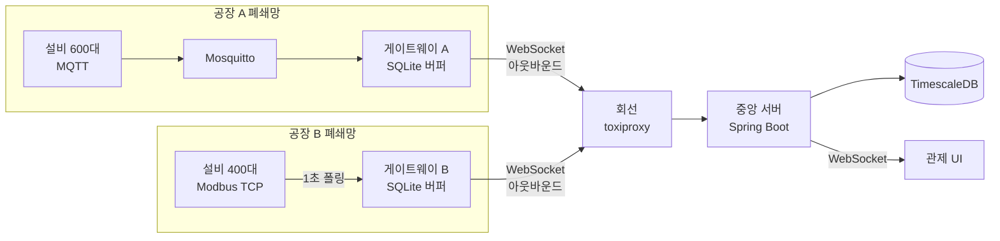
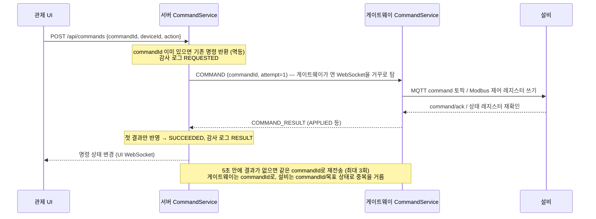
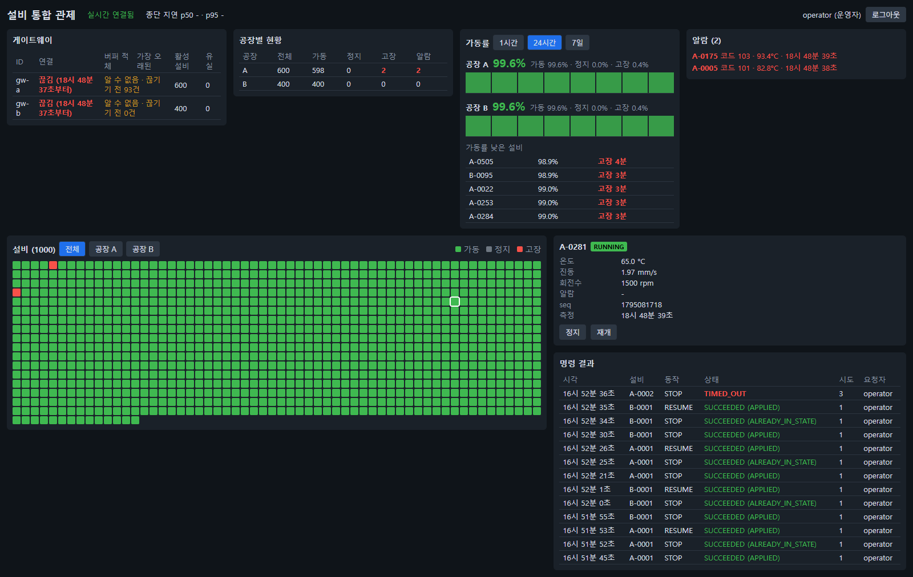

# 폐쇄망 공장 엣지 게이트웨이와 설비 통합 관제 — 설계 문서

> 비전스페이스 채용 과제. 양식의 목차를 유지했다. 수치는 모두 2026-11-19 compose 전체 구성에서 실측한 값이다 (10장).

## 1. 요약
- 무엇을 만들었는가: 설비 1,000대 에뮬레이터(MQTT 600, Modbus TCP 400, 중복·순서 뒤바뀜·지연 주입), 공장별 엣지 게이트웨이(수집 → 정규화 → SQLite 디스크 버퍼 → WebSocket 전송, 원격 명령 중계), 중앙 서버(Spring Boot 4 헥사고날, TimescaleDB 저장, 중복 제거, 명령 재시도·감사 로그, 운영자/조회자 인증), 관제 UI(React, nginx). `docker compose up --build` 한 번으로 폐쇄망 2곳 + 회선(toxiproxy) + 중앙이 뜨도록 구성했다.
- 핵심 설계 결정 3가지
  1. **연결은 게이트웨이가 먼저 여는 WebSocket 하나.** 데이터 업로드와 원격 명령이 같은 연결을 쓴다. 공장망의 "아웃바운드만 허용" 조건을 그대로 만족한다.
  2. **최소 한 번 전달 + 서버 측 중복 제거.** 게이트웨이는 디스크(SQLite)에 먼저 쓰고, 서버가 DB 커밋 후 보낸 ack를 받아야 지운다. 재전송으로 생기는 중복은 서버가 `(device_id, seq)` 유니크 키로 버린다.
  3. **프로토콜이 달라도 중복·순서 기준은 `(device_id, seq)` 하나.** MQTT는 payload의 seq, Modbus는 레지스터의 샘플 카운터를 쓴다.
- 달성한 수치 / 달성하지 못한 것: compose 전체 구성에서 측정했다 (10장).
  - **두 회선 10분 단절 후 유실 0건, 중복 0건** (단절 구간 약 60만 건, 6회 측정 모두)
  - 정상 상태 처리량 초당 991건 (설비 1,000대 × 1초), 측정 → DB 저장 p95 1.7초(MQTT)·1.0초(Modbus)
  - **복구 시간 66초 (목표 120초).** 처음 128초로 목표를 넘겨 원인(서버의 묶음당 고정 비용)을 찾고 묶음 크기를 키워 79초, 서버 병렬 저장으로 66초
  - **회선 복구 10초 뒤 화면이 실시간으로 돌아온다** (개선 전 130초). 새 데이터를 먼저 보내고 밀린 데이터는 뒤에서 채우는 방식 (7장, 10장)
  - 2일 지난 시계열은 압축해 저장 용량을 8분의 1로 줄였다 (실측)
  - 원격 명령은 compose 환경에서 MQTT·Modbus 설비 모두 왕복 확인 (요청 → 설비 적용 → 결과 0.5~2.8초, 멱등·권한·회선 단절 중 시간 초과 포함, `scripts/command-check.sh`). 선택 구현은 가동률 KPI만 했다 (6장)

## 2. 문제 정의와 가정

### 풀려는 문제
공장 2곳(A: MQTT 600대, B: Modbus TCP 400대)의 설비 1,000대를 중앙에서 실시간으로 관제한다. 공장망은 폐쇄망이라 밖으로 나가는 연결만 허용되고, 회선이 수시로 끊긴다. 회선이 끊겨도 데이터를 잃지 않아야 하고, 정지·재개 명령은 정확히 한 번 적용된 것과 같은 결과를 내야 한다.

### 사용자
관제실 운영자. 공장·설비 상태를 한눈에 보고, 이상이 있는 설비를 원격으로 정지·재개한다. 회선 장애 시에는 어느 공장이 끊겼고 얼마나 쌓였는지를 알아야 한다.

### 직접 세운 가정과 근거
| # | 가정 | 근거 |
|---|---|---|
| 1 | MQTT 설비는 payload에 단조 증가 seq와 측정 시각을 넣는다 | 중복·순서 판단에 설비 쪽 순번이 필요하다. 산업용 MQTT 장비는 보통 시퀀스 번호를 지원한다 |
| 2 | Modbus 설비는 레지스터 0~1번에 32비트 샘플 카운터를 둔다 | Modbus에는 메시지 순번 개념이 없다. PLC 하트비트 카운터는 흔한 설계다. 같은 값을 두 번 읽으면 중복으로 처리된다 |
| 3 | Modbus 측정 시각은 게이트웨이 폴링 시각으로 한다 | 레지스터에 시각이 없다. 오차는 폴링 주기(1초) 이내 |
| 4 | Modbus 설비 400대는 라인 컨트롤러 4대(포트 5020~5023) 아래 unit 1~100으로 붙어 있다 | Modbus unit ID는 247개가 한계라 한 포트에 400대를 둘 수 없다 |
| 5 | 공장 내부망은 물리적으로 분리돼 있어 내부 MQTT 브로커는 인증 없이 둔다 | 과제 범위를 회선·서버 쪽 보안에 집중하기 위해. 운영에서는 TLS + 계정이 필요하다 (12장) |
| 6 | 게이트웨이 토큰은 설치 시 발급돼 장비에 저장돼 있다 | 게이트웨이는 사람이 로그인하지 않는 장비다 |
| 7 | 게이트웨이 디스크 버퍼 상한은 6시간 분량이다 | 공장 A 기준 600대 × 21,600초 ≈ 1,300만 건. 넘으면 가장 오래된 것부터 버리고 유실 건수를 알람으로 올린다 |
| 8 | 서버와 게이트웨이 시계는 NTP로 맞춰져 있다 | 종단 지연 측정은 같은 호스트의 컨테이너끼리 하므로 시계 차이가 없다 |
| 9 | 원격 명령은 정지·재개 두 가지, 운영자 권한이 있어야 실행할 수 있다 | 과제 요구 사항 |
| 10 | 설비의 seq 카운터는 재부팅해도 이어진다 (비휘발) | 0부터 다시 세면 서버가 `(deviceId, seq)` 기준으로 새 데이터를 전부 중복으로 버린다. 에뮬레이터는 시작 시각(epoch 초)을 초기값으로 써서 재현한다 |
| 11 | MQTT 설비는 같은 commandId를 다시 받으면 처음 결과를 그대로 돌려준다 | 재시도가 몇 번 와도 설비에 한 번만 적용되게 하는 마지막 방어선. Modbus는 commandId를 실을 곳이 없어 게이트웨이가 대신 기억한다 (3단계) |
| 12 | 에뮬레이터의 MQTT 설비 600대는 브로커 연결 하나를 공유한다 | 브로커·게이트웨이 입장에서 보이는 토픽·QoS·페이로드는 같다. 연결 600개는 검증 대상(게이트웨이)과 무관한 부하라 뺐다 |
| 13 | **유실 0의 범위는 게이트웨이가 데이터를 받아 디스크에 기록한 시점부터 DB 저장까지다.** 설비 → 브로커 → 게이트웨이 구간은 설비의 오프라인 버퍼와 브로커 설정(persistence, 대기열 상한)으로 최대한 줄이되 0을 보장하지는 않는다 | 게이트웨이가 받지 못한 데이터는 게이트웨이가 지킬 수 없다. 과제 원문의 유실 0 요구는 "단절 중 로컬 저장, 복구 후 재전송"(필수 2·6)이다. 브로커 강제 종료 30초 실측: 게이트웨이 이후 구간 유실 0, 브로커 구간 1,726건 (persistence를 켜기 전 23,597건, 8장) |
| 14 | **"회선 단절"은 공장 ↔ 중앙 회선(게이트웨이 ↔ 서버)의 단절로 해석한다.** toxiproxy 설정으로 주입한다 | 시나리오의 "외부로 나가는 연결만 허용되고, 회선은 수시로 끊깁니다"가 공장 밖으로 나가는 회선을 말한다. 설비 쪽 이상(지연·중복·순서 뒤바뀜)은 에뮬레이터 설정으로 주입한다 |
| 15 | **게이트웨이 정지 허용 시간은 10분이다.** 그동안 공장 A 데이터는 브로커 대기열(36만 건)이 보관한다 | 게이트웨이 재시작·업데이트, 정전 복구 뒤 늦은 부팅이 몇 분 안에 끝난다고 본다. 넘으면 브로커가 버린다 (회선 단절은 게이트웨이 디스크가 6시간을 견디는 것과 다르다). 공장 B(Modbus)는 게이트웨이가 꺼지면 폴링이 멈춰 그 사이 샘플이 남지 않는다 (12장) |
| 16 | **게이트웨이와 공장 브로커는 UPS에 연결한다** (배치 요구사항) | 정전이면 브로커 메모리에 있던 "설비에게는 받았다고 했지만 게이트웨이가 아직 가져가지 않은" 메시지가 사라진다. 이 구간은 브로커 persistence로도 막을 수 없다 (스냅숏 방식). 브로커 강제 종료 실측에서 이 구간은 약 2초분(설비당 1~3건, 600대 약 1,100건)이었다 (8장). 게이트웨이 디스크 버퍼는 커밋마다 디스크에 강제 기록하므로 정전에도 남는다 (설정상 근거, 실제 전원 차단 시험은 하지 않음) |

## 3. 요구 사항
| 구분 | 요구 사항 | 목표 수치 | 달성 여부 |
|---|---|---|---|
| 기능 | 설비 1,000대 1초 주기 수집 | 초당 1,000건 | **달성.** 정상 상태 120초 동안 초당 991.1건 저장 (10장) |
| 기능 | 단절 중 로컬 저장, 복구 후 재전송 | 10분 단절 후 유실 0건 | **달성.** 두 회선 600초 차단, 구간 599,995건에서 설비별 seq 빈 번호 0 (2회 측정 모두 0, 10장). 게이트웨이 재시작·ack 유실은 테스트로 확인 (`SqliteOutboxTest`, `GatewayUplinkEndToEndTest`) |
| 기능 | 중복 제거, 순서 보정 | 저장 결과 중복 0건 | **달성.** TimescaleDB에서 정상 상태(에뮬레이터가 1% 중복 주입)와 10분 단절 재전송 모두 중복 0건 (10장) |
| 기능 | 원격 정지·재개 (응답 확인, 시간 초과, 재시도, 멱등, 감사 로그) | 같은 명령 재시도 시 1회만 적용 | 구현. 실제 게이트웨이 명령 처리 코드까지 왕복하는 테스트로 확인 (`GatewayUplinkEndToEndTest`, `ApiEndToEndTest`) |
| 기능 | 관제 UI (현황, 알람, 명령 결과, 게이트웨이 연결·적체) | — | 구현. 로컬은 타입 검사만, 화면 동작은 **미확인** (9장) |
| 비기능 | 종단 지연 (설비 측정 → 화면 전달) | p95 2초 이내 (가정) | 측정 → DB까지는 p95 1.7초(A)·1.0초(B). 화면까지는 **미측정** (10장) |
| 비기능 | 복구 시간 (회선 복구 → 적체 해소) | 10분 적체를 2분 안에 소진 (가정) | **달성. 66초** (gw-a 66초, gw-b 46초). 개선 전 128초. 화면은 10초 뒤 실시간 복귀 (10장) |

수치는 2026-11-19에 compose 전체 구성에서 `scripts/measure.sh`로 잰 값이다 (10장).

## 4. 전체 아키텍처



### 데이터 흐름
1. 설비 → 게이트웨이: MQTT 구독 또는 Modbus 폴링
2. 게이트웨이: 공통 모델로 정규화 → SQLite outbox에 기록 (이 시점부터 유실 없음)
3. 게이트웨이 → 서버: outbox에서 꺼내 묶음 전송. 회선 복구 직후에는 새 데이터를 먼저 보내고 밀린 데이터는 뒤에서 채운다 (백필, 7장)
4. 서버: DB 커밋 (중복은 유니크 키로 무시) → 묶음 범위로 ack → 게이트웨이가 outbox에서 그 범위만 삭제
5. 서버 → UI: 설비 현재 상태가 바뀌면 WebSocket으로 전달

### 명령 흐름


| 단계 | 멱등을 지키는 장치 |
|---|---|
| UI → 서버 | commandId를 UI가 만든다. 더블클릭·HTTP 재전송은 같은 commandId라 명령이 하나만 생긴다 |
| 서버 → 게이트웨이 재시도 | 같은 commandId로만 재전송. 결과는 첫 번째만 반영하고 나머지는 감사 로그에 `DUPLICATE_RESULT_IGNORED` |
| 게이트웨이 | commandId별 결과를 기억해 재실행 없이 재전송. 단 `DEVICE_UNREACHABLE`은 기억하지 않아 다시 실행 |
| 설비 | MQTT: commandId별 첫 결과를 기억. Modbus: 이미 목표 상태면 쓰지 않음 (`ALREADY_IN_STATE`) |

명령 상태: `PENDING`(게이트웨이 미연결) → `SENT` → `SUCCEEDED`(APPLIED, ALREADY_IN_STATE) / `FAILED`(UNKNOWN_DEVICE) / `TIMED_OUT`(3회 시도 후).
감사 로그(`command_audit`)는 추가만 하며 REQUESTED, SENT, SEND_FAILED, RESULT, DUPLICATE_RESULT_IGNORED, RETRY, TIMED_OUT을 행위자(사용자/system/게이트웨이)와 함께 남긴다.

## 5. 구성 요소별 책임
| 구성 요소 | 책임 | 기술 | 선택 이유 |
|---|---|---|---|
| 에뮬레이터 | 설비 1,000대 모사, 중복·순서 뒤바뀜·지연 주입 | Java 25 가상 스레드, Paho, j2mod | 1,000개 동시 실행이 가상 스레드로 간단하다 |
| 게이트웨이 | 수집, 정규화, 디스크 버퍼, 재전송, 명령 중계 | Java 25 (Spring 없음), SQLite | 엣지 장비 자원이 작다고 가정. SQLite는 별도 프로세스 없이 디스크에 안전하게 쓴다 |
| 회선 | 단절·지연 재현 | toxiproxy | 실제 TCP 연결을 끊고 지연시켜 애플리케이션 코드 수정 없이 장애를 만든다 |
| 중앙 서버 | 인증, 중복 제거, 저장, UI 전달, 명령 관리 | Spring Boot 4, 헥사고날 | 핵심 규칙(중복 제거·현재 상태 갱신·명령 상태 기계)을 WebSocket·DB와 분리해 메모리 구현으로 테스트할 수 있다. 실제로 DB 없이 종단 테스트를 돌렸다 |
| 관제 UI | 현황, 알람, 명령, 게이트웨이 상태 | Vite + React + TS, nginx | 상태 관리 라이브러리 없이 순수 함수로 갱신 규칙을 분리. nginx가 같은 주소로 프록시해 CORS가 필요 없다 |
| 저장소 | 시계열 저장 | TimescaleDB | Postgres 그대로라 유니크 키·트랜잭션을 쓸 수 있고 시계열 압축·보관 정책이 있다 |

## 6. 데이터 모델과 메시지 스키마

### 공통 데이터 모델 (`TelemetryRecord`)
| 필드 | 타입 | 설명 |
|---|---|---|
| deviceId | string | `A-0001` ~ `A-0600`, `B-0001` ~ `B-0400` |
| factoryId | string | `A`, `B` |
| protocol | enum | `MQTT`, `MODBUS` |
| seq | long | 설비 단위 단조 증가 순번 |
| deviceTs | long (ms) | 측정 시각 |
| gatewayTs | long (ms) | 게이트웨이 수신 시각 |
| state | enum | `RUNNING`, `STOPPED`, `FAULT` |
| temperature | double | °C |
| vibration | double | mm/s |
| rpm | int | |
| alarmCode | int | 0 = 정상 |

### 프로토콜별 매핑표

**MQTT (공장 A)** — 토픽 `factory/A/device/{deviceId}/telemetry`, QoS 1

| 원본 필드 | 공통 필드 |
|---|---|
| 토픽의 `{deviceId}` | deviceId |
| `seq` | seq |
| `ts` | deviceTs |
| `state` (문자열) | state |
| `temp` | temperature |
| `vib` | vibration |
| `rpm` | rpm |
| `alarm` | alarmCode |

명령: `factory/A/device/{deviceId}/command` 로 발행 → 설비가 `.../command/ack` 로 응답

**Modbus TCP (공장 B)** — 라인 컨트롤러 4대(포트 5020~5023), 포트당 unit 1~100, Holding Register

| 레지스터 | 원본 | 공통 필드 | 변환 |
|---|---|---|---|
| 0~1 | 샘플 카운터 (uint32, 상위·하위) | seq | `(r0 << 16) \| r1` |
| 2 | 상태 코드 | state | 1=RUNNING, 2=STOPPED, 3=FAULT |
| 3 | 온도 × 10 | temperature | ÷ 10 |
| 4 | 진동 × 100 | vibration | ÷ 100 |
| 5 | 회전수 | rpm | 그대로 |
| 6 | 알람 코드 | alarmCode | 그대로 |
| 10 | 제어 (쓰기 전용) | — | 1=RESUME, 2=STOP |
| (없음) | — | deviceTs | 게이트웨이 폴링 시각 (가정 3) |

deviceId 변환: `B-` + `((포트 - 5020) × 100 + unit)` 를 4자리로

인코딩·디코딩 코드는 `common/.../modbus/ModbusRegisterMap.java` 하나를 에뮬레이터(쓰기)와 게이트웨이(읽기)가 함께 쓴다.
온도는 영하를 표현할 수 있게 int16(2의 보수)으로 넣는다.

### 에뮬레이터 장애 주입 (2단계)
| 장애 | 대상 | 방식 | 설정 (환경 변수) |
|---|---|---|---|
| 중복 | MQTT | 같은 메시지를 연달아 두 번 발행 | `FAULT_DUPLICATE_RATE` (기본 1%) |
| 순서 뒤바뀜 | MQTT | 이번 메시지를 붙잡았다가 다음 메시지 뒤에 발행 (seq 5 → 4 순서로 도착) | `FAULT_REORDER_RATE` (기본 1%) |
| 지연 | MQTT | 발행 전 0~N ms 대기. 측정 시각(ts)은 지연 전 값이라 종단 지연에 그대로 반영된다 | `FAULT_DELAY_MAX_MS` (기본 300) |
| 설비 고장 | 공통 | 1초마다 확률적으로 FAULT + 알람 코드(101~103), 10~30초 뒤 자동 복구 | `DEVICE_FAULT_RATE` (기본 0.02%) |
| 중복 읽기 | Modbus | 주입하지 않아도 폴링 특성상 같은 카운터를 두 번 읽으면 생긴다 | — |

Modbus 설비는 게이트웨이가 읽어 가는 구조라 중복·순서 장애를 따로 주입하지 않는다.
알려진 한계: 레지스터 0~6을 하나씩 갱신하므로 게이트웨이가 정확히 그 사이에 읽으면 값 하나가 1초 전 값일 수 있다. 카운터를 마지막에 써서 "새 seq + 옛 값" 조합은 피한다.

### 저장 구조와 보관 정책
| 테이블 | 종류 | 키 | 보관 | 용도 |
|---|---|---|---|---|
| `telemetry` | hypertable (device_ts, 1일 청크) | (device_id, device_ts, seq) | 30일 (retention policy). 2일 지난 청크는 압축 (V4) | 시계열 원본. `server_ts`로 저장 시각 기록 |
| `telemetry_dedup` | 일반 테이블 | **(device_id, seq)** | 2일 (서버 스케줄러가 10분마다 정리) | 중복 판정 전용 |
| `device_current` | 일반 테이블 | device_id | 영구 | 설비 현재 상태. seq가 더 클 때만 갱신 |
| `ingest_rejected` | 일반 테이블 | id | 영구 (운영자가 확인 후 정리) | 저장할 수 없는 레코드 격리 (8장 "잘못된 데이터") |
| `device_state_1m` | 연속 집계 (V5) | (bucket 1분, device_id) | 30일 | 가동률 KPI. 1분마다 설비별 상태 샘플 수를 미리 센다 (아래 "KPI 집계") |

**용량**
- 실측 1행 약 200B, 초당 1,000건이면 원본 30일에 약 520GB다. 그래서 2일 지난 청크를 설비별로 묶어 열 단위로 압축한다(`segmentby = device_id`).
- 압축 대상을 2일 지난 청크로 잡은 이유: 늦게 오는 데이터는 버퍼 상한(6시간) 안에서만 생기므로, 2일 지난 청크에는 쓰기가 오지 않는다.
- 중복 판정표는 이틀 보관에 약 1.7억 행·17GB다. 이보다 커지면 날짜별 테이블로 나눠 통째로 지우는 방식이 낫다 (12장).

**왜 중복 판정 테이블을 따로 두나**: TimescaleDB hypertable의 유니크 인덱스에는 시간 파티션 컬럼이 반드시 들어가야 한다.
그래서 `(device_id, seq)` 단독 유니크를 hypertable에 걸 수 없고, `(device_id, seq, device_ts)`로 걸면
같은 seq를 다른 시각에 다시 읽은 경우(Modbus 재읽기 등)를 중복으로 못 잡는다.
일반 테이블에 `(device_id, seq)` 기본 키를 두고, 한 SQL 문(CTE) 안에서 "중복 판정 테이블에 넣기 → 새로 들어간 키만 hypertable에 넣기"를 한다.
재전송 중복은 게이트웨이 버퍼 보관 시간(최대 6시간) 안에서만 생기므로 판정 기록은 2일이면 충분하다.

**쓰기 방식**: 묶음(최대 2,000건)을 열마다 배열 하나로 보내 `unnest`로 펼친다. 왕복 1번, 문장 1개.
현재 상태 갱신은 `INSERT ... ON CONFLICT DO UPDATE ... WHERE c.seq < EXCLUDED.seq` 한 문장이며,
같은 행을 한 문장에서 두 번 갱신할 수 없으므로 묶음을 먼저 설비당 최신 1건으로 줄인다 (`LatestPerDevice`).
저장과 현재 상태 갱신은 한 트랜잭션이고, 화면 알림은 커밋 뒤에 보낸다.

**병렬 저장과 교착 방지**: 서버는 한 게이트웨이의 묶음을 작업 풀(기본 4개)에서 동시에 저장한다 (7장). 복구 중 백필 묶음들은 같은 설비 수백 대를 함께 담고 있어 여러 트랜잭션이 같은 `device_current` 행을 잠근다. 묶음 1이 A→B, 묶음 2가 B→A 순서로 잠그면 서로 기다리며 멈춘다(교착). 그래서 현재 상태 행은 설비 ID 순으로, 중복 판정 키는 `(device_id, seq)` 순으로 잠근다. 모든 트랜잭션이 같은 순서로 잠그면 한쪽이 잠시 기다릴 뿐 교착이 생기지 않는다 (`JdbcTelemetryRepositoryTest`: 같은 설비 200대를 서로 다른 순서로 담은 묶음 8개 동시 저장).

### KPI 집계 (선택 구현)
- **가동률 = 가동(RUNNING) 샘플 수 ÷ 전체 샘플 수.** 설비가 1초마다 보고하므로 "가동한 초 ÷ 보고한 초"다
- OEE(가동률 × 성능 × 품질) 중 성능·품질은 생산 수량과 불량 수가 있어야 계산할 수 있는데 이 데이터에는 없다. 그래서 가동률만 낸다
- **연속 집계(continuous aggregate)** `device_state_1m`이 1분마다 설비별 상태 샘플 수를 미리 센다. 24시간 KPI를 원본 8,640만 행 대신 집계 약 144만 행에서 읽는다
- 집계 갱신 범위는 "7시간 전 ~ 1분 전"이다. 회선이 끊기면 데이터가 최대 6시간(게이트웨이 버퍼 상한) 늦게 도착하는데, 그 늦은 데이터도 집계에 반영돼야 단절 구간의 가동률이 비지 않는다
- 아직 집계되지 않은 최근 1분은 원본에서 바로 세어 합친다 (`materialized_only = false`). 화면이 1분 늦지 않다
- API: `GET /api/kpi?hours=24` → 공장별 가동률, 시간대별 추이, 가동률 낮은 설비 5대. 화면은 1분마다 다시 읽는다
- 주의: 데이터가 이미 쌓인 DB에 V5를 적용하면 정책은 최근 7시간만 집계한다. 그 이전은 한 번 수동으로 채운다: `CALL refresh_continuous_aggregate('device_state_1m', NULL, now() - interval '1 minute')` (트랜잭션 안에서 실행할 수 없어 마이그레이션에 넣지 않았다)

## 7. 인터페이스 명세

### 게이트웨이 ↔ 서버 WebSocket (`/ws/gateway`)
프레임: `{"type": "...", "body": {...}}`. 계약은 `common/.../wire/WireMessages.java`에 있다.

| type | 방향 | body | 설명 |
|---|---|---|---|
| BATCH | 게이트웨이 → 서버 | gatewayId, fromOutboxId, toOutboxId, records[] | outbox 묶음 |
| ACK | 서버 → 게이트웨이 | fromOutboxId, toOutboxId | 이 범위의 묶음 DB 커밋 완료 (범위 ack, 받은 BATCH의 from/to를 그대로) |
| GATEWAY_STATUS | 게이트웨이 → 서버 | bufferedCount, oldestBufferedAgeMs, connectedDevices, droppedCount | 5초마다. droppedCount > 0이면 버퍼 상한 초과 유실 |
| COMMAND | 서버 → 게이트웨이 | commandId, deviceId, action, attempt | commandId가 멱등 키 |
| COMMAND_RESULT | 게이트웨이 → 서버 | commandId, outcome, detail | |

순서: 서버는 BATCH를 작업 풀에서 **병렬로 저장**하므로 저장이 끝나는 순서와 ack 순서가 받은 순서와 다를 수 있다. 게이트웨이도 실시간 데이터와 밀린 데이터를 섞어 보내므로 **BATCH의 outboxId 순서는 보장하지 않는다.** 그래서 서버도 게이트웨이도 순서에 기대지 않는다. ack는 범위 단위이고, 중복은 `(device_id, seq)`로, 설비 현재 상태는 seq가 클 때만 갱신하므로 늦게 온 옛 데이터가 최신 값을 덮지 않는다.

게이트웨이 전송 규칙 (`gateway/.../uplink/Uplink.java`)
- **두 줄 전송.** 연결 순간 outbox의 최대 id를 경계로 나눈다.
  - 그 이하(끊긴 동안 쌓인 것)는 백필 줄로 보낸다. 오래된 순서대로, 남는 슬롯(window − 1)을 쓴다
  - 그 이후(연결 뒤 들어온 것)는 실시간 줄로 보낸다. 항상 먼저 보내고, 동시에 한 묶음만 보낸 상태로 둔다. ack를 기다리는 동안 쌓인 것은 다음 묶음에 모은다
- BATCH 하나에 최대 2,000건, ack 없이 최대 3개(실시간 1 + 백필 2, 환경 변수 `WINDOW`)까지 연달아 보낸다. 동시에 저장되는 묶음 수는 이 창 크기가 막는다 (10장 실측)
- **범위 ack.** 두 줄이 섞여 나가므로 "X번까지 전부"라는 누적 ack를 쓰면 실시간 묶음의 ack로 아직 안 보낸 백필이 지워진다. 그래서 서버는 받은 묶음의 범위를 그대로 돌려주고, 게이트웨이는 **자기가 보낸 묶음과 범위가 정확히 같을 때만** 그 범위를 지운다. 맞지 않는 ack는 무시한다(남겨 두면 다시 보낼 뿐이고, 잘못 지우면 유실이다)
- outbox에 남은 행이 곧 "서버 저장이 확인되지 않은 행"이다. 재연결·재시작 때 별도 기록 없이 남은 것을 다시 두 줄로 나눠 보낸다
- 가장 오래된 미확인 BATCH가 15초 안에 ack 되지 않으면 연결을 끊고 다시 연결한다 (TCP는 살아 있는데 응답이 없는 회선 대비)
- 재연결 대기: 0.5초부터 두 배씩, 최대 30초, [절반, 전체] 구간 무작위 (여러 게이트웨이가 동시에 몰리지 않게)
- 인증: 핸드셰이크 헤더 `Authorization: Bearer <게이트웨이 토큰>`, `X-Gateway-Id`

명령 멱등 (게이트웨이)
- 같은 commandId가 다시 오면 실행하지 않고 처음 결과를 다시 보낸다
- `DEVICE_UNREACHABLE`은 기억하지 않는다 → 서버 재시도 시 다시 실행. MQTT 설비는 commandId로, Modbus는 "이미 목표 상태면 쓰지 않음"으로 두 번 적용되지 않는다

### REST API (관제 UI → 서버, nginx `/api` 프록시)
모든 요청은 `Authorization: Bearer <토큰>` 필요 (로그인 제외). 토큰이 없거나 만료면 401.

| 메서드 | 경로 | 권한 | 요청 | 응답 |
|---|---|---|---|---|
| POST | /api/login | — | `{username, password}` | 200 `{token, username, role, expiresAt}` / 401 |
| POST | /api/logout | 로그인 | — | 204 |
| GET | /api/me | 로그인 | — | `{username, role}` |
| GET | /api/devices | 로그인 | — | 설비 현재 상태 목록 |
| GET | /api/gateways | 로그인 | — | 게이트웨이 연결·적체·유실 |
| GET | /api/commands?limit=50 | 로그인 | — | 최근 명령 (최신순, 최대 500) |
| GET | /api/commands/{id}/audit | 로그인 | — | 감사 로그 |
| GET | /api/kpi?hours=24 | 로그인 | — | 가동률 KPI: 공장별·시간대별·가동률 낮은 설비 5대 (1~168시간) |
| POST | /api/commands | **OPERATOR** | `{commandId, deviceId, action: STOP\|RESUME}` | 202 명령 (결과는 비동기) / 400 모르는 설비·필수값 누락 / 403 조회자 / 409 같은 commandId로 다른 요청 |

### UI WebSocket (`/ws/ui?token=...`, 서버 → 화면 단방향)
| type | 내용 | 시점 |
|---|---|---|
| snapshot | devices[], gateways[], commands[], serverTime | 접속 직후 1회 (재접속 시 다시) |
| devices | items[] (설비당 최신 1건), serverTime | 0.25초마다 모아서 |
| gateway | item | 연결·끊김·상태 보고 때 즉시 |
| command | item | 명령 상태가 바뀔 때 즉시 |

브라우저 WebSocket API는 헤더를 붙일 수 없어 토큰을 쿼리로 보낸다 (nginx는 이 경로의 접근 로그를 끈다).

### 인증·권한
| 주체 | 방식 | 권한 |
|---|---|---|
| 게이트웨이 | 설치 시 발급 토큰 (핸드셰이크 헤더), 상수 시간 비교 | 자기 공장 데이터 업로드, 명령 수신 |
| operator | 로그인 → 32바이트 무작위 토큰 (서버 메모리, 8시간) | 조회 + 정지·재개 |
| viewer | 같음 | 조회만 (명령 403, 화면 버튼 비활성) |

JWT 대신 서버 메모리 세션을 쓴 이유: 서버 1대 구성이라 상태를 서버에 두는 것이 가장 단순하고, 로그아웃·만료가 즉시 반영된다. 서버를 여러 대로 늘리면 공유 세션 저장소나 JWT가 필요하다 (12장).

## 8. 장애 시나리오
| 상황 | 감지 방법 | 대응 | 복구 절차 | 검증 방법·결과 |
|---|---|---|---|---|
| 연결 끊김 (회선) | WebSocket 종료·전송 실패, 또는 ack 15초 무응답 | 수집은 계속, SQLite outbox에 적체. 화면은 적체를 "알 수 없음 · 끊기기 전 N건"으로 표시 (끊긴 동안 실제 값을 모르므로) | 백오프 재연결 → 새 데이터는 실시간 줄로 먼저, 밀린 데이터는 백필로 (7장). ack 못 받은 것은 outbox에 남아 있어 다시 나간다 | `UplinkTest` 실시간 우선·범위 ack·재연결·시간 초과, `GatewayUplinkEndToEndTest` ack 유실 후 재전송. `measure.sh outage` 10분 단절: 유실 0·중복 0 (10장) |
| 브로커 → 게이트웨이 구간 | — | MQTT 수동 ack: 디스크 커밋 후 PUBACK. 영속 세션으로 게이트웨이 정지 중 메시지 브로커 보관 | 재연결 시 브로커가 미확인 메시지 재전송 | `MqttCollectorTest`, `IngestWriterTest` |
| 게이트웨이 재시작 | — | outbox가 디스크에 남음 (WAL, synchronous=FULL) | 기동 시 남은 것부터 전송. AUTOINCREMENT라 id가 되돌아가지 않음 | `SqliteOutboxTest` 재시작·id 비재사용. **강제 종료(kill -9) 실측, MQTT 게이트웨이: 30초·200초 정지 유실 0·중복 0, 회복 11초. 900초 정지(허용 10분 초과)는 187,108건 유실 = 브로커 대기열 상한(36만 건)을 넘은 만큼으로 설계대로다 (가정 15).** 상한이 10만 건이던 때는 200초 정지에 25,592건 유실 → 36만 건으로 올림. Modbus 게이트웨이는 꺼진 동안 아무도 폴링하지 않아 그 사이 샘플이 수집 단계에서 빠진다 (실측 약 13,000건 = 400대 × 약 33초, 12장 한계) |
| 같은 토큰으로 게이트웨이 둘이 접속 (설정 복제, 토큰 유출) | 서버가 게이트웨이별 최근 1분 접속 횟수를 센다. 5회 이상이면 화면에 "같은 토큰 중복 사용 의심", ERROR 로그 | 서버는 나중에 붙은 연결을 남긴다 (반쯤 죽은 옛 연결이 새 연결을 막지 않게). 둘이 서로 밀어내며 초당 1회 넘게 재접속하고, MQTT 세션도 서로 빼앗는다 | 한쪽을 멈추기 전에 그쪽 적체가 0이 될 때까지 기다린다. 데이터가 두 디스크로 나뉘어 있어 그냥 지우면 미전송분이 유실된다 (실측 60초 중복 후 지운 쪽 275건) | `GatewayPresenceServiceTest`, compose에서 복제 게이트웨이 실측 (1분 71회 재접속, 경고 표시 확인) |
| 디스크 버퍼 가득 참 | 행 수 > 상한(6시간분) | 가장 오래된 것부터 버리고 droppedCount 증가 | 서버·UI에 유실 알람 | `SqliteOutboxTest` 상한 초과 |
| 메시지 중복 | 설비 재발행, 재전송, Modbus 중복 읽기 | Modbus는 게이트웨이에서 이미 본 seq 제거. 나머지는 서버가 `telemetry_dedup`의 (deviceId, seq) 기본 키로 제거 | — | `ModbusNormalizerTest`, `IngestServiceTest` 재전송 묶음, `GatewayUplinkEndToEndTest` |
| 순서 뒤바뀜 | 같은 설비의 seq가 줄어듦 | 저장은 그대로(시계열은 측정 시각 기준), 현재 상태는 seq가 클 때만 갱신 | — | `LatestPerDeviceTest`, `IngestServiceTest` 늦게 온 옛 기록 |
| 서버 재시작 | 연결 끊김과 같음 | 커밋 전 묶음은 ack가 안 나가므로 게이트웨이가 재전송 | 같은 절차 | `IngestServiceTest` 실패 시 롤백·ack 없음. **강제 종료 30초 실측: 유실 0·중복 0, 기동 후 회복 33초** (Spring 기동 약 15초 + 재연결 대기) |
| DB 중단 | 저장 실패 → 서버가 ack 없이 연결을 끊음 | 게이트웨이에 쌓였다가 재연결 후 재전송. 실패한 묶음의 중복 판정 기록도 롤백되므로 재전송분이 버려지지 않는다 (`JdbcTelemetryRepositoryTest`) | DB 기동 후 자동 | **TimescaleDB 강제 종료 30초 실측: 유실 0·중복 0, 회복 18초** |
| 공장 내부 브로커 다운 | 게이트웨이 상태 보고의 활성 설비 수가 0으로 떨어짐 (서버 연결은 유지) | 게이트웨이는 브로커 재연결을 계속 시도. 전송·상태 보고는 별도 스레드라 멈추지 않아 디스크 미전송분은 계속 올라간다. 이 동안 명령은 DEVICE_UNREACHABLE → 서버 재시도 | 설비는 끊긴 동안 발행분을 버퍼에 두었다가 재연결 즉시 보낸다. **브로커는 persistence 스냅숏에서 게이트웨이의 구독(영속 세션)을 되살려**, 게이트웨이가 다시 붙기 전에 온 메시지도 대기열에 보관한다. 설비 측 QoS 1 재발행분은 서버 중복 제거 | **브로커 강제 종료 30초 실측: 게이트웨이 이후 구간 유실 0·중복 0, 회복 11초. 브로커 구간 유실은 persistence 끔 23,597건 → 켬 1,726건.** 끈 상태의 원인: 브로커 재시작과 함께 게이트웨이 구독이 사라져, 설비가 먼저 재연결해 보낸 메시지가 게이트웨이 재구독 전 7~17초 동안 받을 곳 없이 버려졌다 (설정 변경용 일반 재시작에서도 20,807건). 남은 1,726건 중 약 1,100건은 종료 순간 브로커 메모리에만 있던 약 2초분으로, 스냅숏 방식이라 막을 수 없다 (가정 16) |
| 잘못된 데이터 (독이 든 메시지) | 저장 전 검사 (`RecordCheck`): 빈 필드, 서버가 모르는 값(새 버전 게이트웨이), 남의 공장 설비, DB가 못 받는 시각, **보관 기간(30일)보다 옛 측정 시각** (설비 시계 초기화. 저장하면 보관 정책이 곧바로 지워 "ack했는데 사라지는" 유실이 된다) | 그 레코드만 `ingest_rejected`에 원문과 이유를 남기고 나머지는 저장 → ack. 예외로 처리하면 ack가 안 나가 같은 묶음을 끝없이 재전송하고 그 뒤 데이터까지 막힌다 | 운영자가 격리 테이블을 보고 원인 조치 | `IngestServiceTest` 격리, `ServerWireCodecTest` 모르는 enum, `RecordCheckTest`, `JdbcTelemetryRepositoryTest` (실제 TimescaleDB) |
| 명령 결과가 시간 초과 뒤 도착 | 시간 초과(5초 × 3회)로 TIMED_OUT 처리한 뒤 결과 수신 | 시간 초과는 "결과 모름"이지 실패가 아니므로, 늦게 온 확정 결과로 상태를 바로잡고 감사 로그 `LATE_RESULT` | — | `RemoteCommandTest`, `CommandServiceTest` 늦은 결과 |

## 9. UI 설계
한 화면 대시보드. 운영자가 "어디가 끊겼나 → 어느 설비가 이상한가 → 조치 → 결과 확인"을 화면 이동 없이 하도록 배치했다.

```
┌ 헤더: 실시간 연결 상태 · 종단 지연 p50/p95 · 사용자(역할) · 로그아웃 ───────────────┐
├ 게이트웨이 (연결/끊긴 시각, 버퍼 적체, 가장 오래된 미전송, 활성 설비, 유실) ┬ 공장별 현황 ┬ 가동률 KPI ┬ 알람 ┤
├ 설비 1,000대 그리드 (가동 초록 / 정지 회색 / 고장 빨강, 공장 필터) ─────┬ 설비 상세 + 정지·재개 ┤
│                                                                        └ 명령 결과 → 클릭 시 감사 로그 ┘
```

| 요구 | 화면 요소 |
|---|---|
| 공장·설비 현황 | 공장별 현황 표, 1,000칸 상태 그리드 (14px 칸, 한 화면에 전부) |
| 알람 | 고장 또는 알람 코드가 있는 설비 목록 (클릭 → 상세) |
| 명령 결과 | 명령 표 (상태·결과·시도 횟수·요청자), 클릭 시 감사 로그 |
| 게이트웨이 연결·적체 | 게이트웨이 표. 끊기면 빨간 "끊김 (시각부터)", 적체 1,000건 초과 노란색, 유실 > 0 빨간색 |
| 가동률 KPI (선택 구현) | 1시간·24시간·7일 선택. 공장별 가동률과 가동·정지·고장 비율, 시간대별 막대, 가동률 낮은 설비 5대 (클릭 → 상세). 1분마다 갱신 |

- 실시간 갱신은 서버가 0.25초마다 묶어 보내는 변경분만 반영한다. 다시 접속하면 스냅샷으로 맞춘다
- 명령 버튼은 조회자에게 비활성. 응답 없이 다시 누르면 **같은 commandId**로 재요청한다 (멱등)
- 구현: Vite + React + TypeScript, 상태 관리·UI 키트 없이 `useState` + 순수 함수(`store.ts`)

### 주요 사용자 흐름
1. **이상 발견 → 조치:** 알람 목록이나 그리드의 빨간 칸 클릭 → 설비 상세 (온도·진동·알람 코드·측정 시각) → 정지 → 명령 결과 표에서 SENT → SUCCEEDED 확인 → 클릭해 감사 로그
2. **회선 장애 파악:** 게이트웨이 표의 "끊김 (시각부터)"과 "알 수 없음 · 끊기기 전 N건"으로 어느 공장이 언제부터 끊겼는지 확인 → 복구 뒤 적체가 줄어드는 것과 헤더 종단 지연이 돌아오는 것으로 복구 확인
3. **조회자:** 같은 화면을 보되 정지·재개 버튼이 비활성. 서버도 403으로 막는다 (화면만 막지 않는다)

### 상태 정의
| 대상 | 정상 | 경고 (노랑) | 장애 (빨강) | 연결 끊김·알 수 없음 |
|---|---|---|---|---|
| 화면 실시간 연결 (헤더) | "실시간 연결됨" | "연결 중…" | — | "연결 끊김". 재접속하면 스냅샷으로 다시 맞춘다 |
| 게이트웨이 | "연결", 적체 1,000건 이하 | 적체 1,000건 초과 / 재연결 직후 "확인 중" | 유실(버퍼 상한 초과 폐기) > 0 / 1분 5회 이상 재접속 "같은 토큰 중복 사용 의심" | "끊김 (시각부터)", 적체는 "알 수 없음 · 끊기기 전 N건" (끊긴 동안 실제 값을 모르므로 숫자로 보이지 않는다) |
| 설비 | 가동 (초록) | 정지 (회색, 운영자가 정지한 상태) | 고장 (빨강) 또는 알람 코드 ≠ 0 → 알람 목록 | 마지막 측정 시각이 상세에 보인다 (회선이 끊기면 갱신이 멈춘다) |
| 명령 | SUCCEEDED | PENDING·SENT (진행 중) | FAILED (모르는 설비) · TIMED_OUT (5초 × 3회 무응답, "결과 모름") | — |

### 화면 이미지
`docs/images/`에 실제 compose 구성에서 헤드리스 브라우저로 캡처한 화면을 둔다.
- `dashboard.png`: 정상 상태 (두 게이트웨이 연결, 설비 1,000대, 명령 결과)
- `dashboard-outage.png`: 두 회선 단절 중 (게이트웨이 "끊김 (시각부터)", 적체 "알 수 없음 · 끊기기 전 N건", 가동률 KPI, 알람, 명령 결과)



## 10. 측정 결과
> 2026-11-19, 개발 PC 1대(Windows 11, Docker Desktop, 엔진 29.9)에서 compose 전체 구성(컨테이너 8개)을 띄워 측정했다.

### 측정 방법 (`scripts/measure.sh`, `scripts/report.sql`)
| 지표 | 방법 | 목표 |
|---|---|---|
| 처리량 | 구간 안 telemetry 행 수 ÷ (마지막 − 처음 server_ts) | 초당 1,000건 |
| 종단 지연 (측정 → DB) | `server_ts − device_ts`의 p50·p95, 공장별 | — |
| 종단 지연 (측정 → 화면) | 브라우저가 받은 시각 − device_ts, 최근 5,000건 p50·p95 (화면 헤더에 표시) | p95 2초 |
| 중복 | 구간 안 `count(*) − count(DISTINCT (device_id, seq))` | 0 |
| 유실 | 설비마다 (마지막 seq − 첫 seq + 1) − 저장된 seq 수 | MQTT 0 |
| 복구 시간 (적체 해소) | toxiproxy로 두 회선 10분 차단 → 복구 시각부터 모든 게이트웨이의 가장 오래된 미확인 레코드가 5초 미만이 될 때까지 | 2분 이내 |
| 실시간 복귀 (`scripts/recovery.sql`) | 복구 뒤 측정된 데이터를 측정 시각 기준 10초 구간으로 나눠 측정 → DB 지연 p95를 본다. 처음으로 2초 미만이 된 구간 | — |

측정상 주의
- 종단 지연은 같은 호스트의 컨테이너끼리라 시계 차이가 없다 (가정 8). 브라우저도 같은 PC에서 연다
- 복구 시간은 게이트웨이 상태 보고 주기(5초)만큼 오차가 있다
- 끊긴 동안 서버가 아는 적체 값은 차단 직전 값에 멈춰 있다. 그래서 게이트웨이마다 복구 뒤 적체 보고를 먼저 확인하고, 그다음 해소 시각을 잰다
- 해소 기준을 "미확인 0건"으로 두지 않았다. 정상 상태에서도 전송 중이거나 ack를 기다리는 수십~수백 건이 늘 있어서 0은 우연히만 찍힌다. 1차 측정은 이 기준 때문에 실제보다 1분 길게(185초) 나왔고, 그 뒤 스크립트를 고쳤다
- MQTT 에뮬레이터는 지연(0~300ms)을 주입하므로 종단 지연에 그만큼 포함된다
- Modbus는 폴링이 샘플을 건너뛰면 수집 단계 누락이 생길 수 있어 유실을 공장별로 나눠 본다 (0.5초 폴링으로 줄임)

### 결과
| 지표 | 결과 | 목표 | 판정 |
|---|---|---|---|
| 처리량 (정상 상태 120초) | 초당 991.1건 (120,990건) | 초당 1,000건 | 달성 |
| 측정 → DB p50 / p95 / 최대, 공장 A (MQTT) | 225 / 1,707 / 4,302 ms | — | 에뮬레이터 지연 주입(0~300ms) 포함 |
| 측정 → DB p50 / p95 / 최대, 공장 B (Modbus) | 40 / 1,004 / 2,719 ms | — | |
| 측정 → 화면 p50 / p95 | 미측정 | p95 2초 | |
| 정상 상태 중복 / 유실 | 0 / 0 (A 600대, B 400대) | 0 / 0 | 달성. 에뮬레이터는 1% 중복을 주입한다 |
| 10분 단절 중 적체 | gw-a 약 35만 건, gw-b 약 22~25만 건, 폐기 0 | — | 가장 오래된 레코드 약 580초 |
| 10분 단절 후 중복 / 유실 | 0 / 0 (매회 구간 약 60만 건) | 0 / 0 | **달성** (6회 측정 모두) |
| 복구 시간 (적체 해소) | **66초** (gw-a 66초, gw-b 46초) | 120초 | **달성** (개선 전 128초, 아래) |
| 실시간 복귀 | **복구 후 10초** (두 공장 모두) | — | 개선 전 130초 |
| 저장 용량 (압축) | 1행 215B → 27B (**8.0배**, 실측 300만 건) | — | 30일 보관 약 560GB → 약 100GB (최근 2일은 비압축) |
| 원격 명령 왕복 (`scripts/command-check.sh`) | 21개 항목 통과 (화면 WebSocket 같은 출처 101·다른 사이트 403 포함). 안정 상태 MQTT 설비 왕복 약 0.4초. 게이트웨이 재시작 직후에는 9.5초(재시도 3회)까지 늘었다 (12장). 정지·재개가 MQTT(A-0001)·Modbus(B-0001) 설비에 적용되고 텔레메트리 상태까지 바뀜. 요청 → 결과 0.5~2.8초 (0.5초 간격 조회라 그만큼 오차) | — | 조회자 403, 같은 commandId 재요청 시 재전송 없음, 다른 내용 재사용 409, 이미 정지 → ALREADY_IN_STATE, 회선 단절 중 → 3회 시도 후 TIMED_OUT, 복구 뒤에도 적용 안 됨 |
| 구성 요소 강제 종료 30초 (`measure.sh fault`) | 서버·DB·MQTT 게이트웨이: 유실 0·중복 0, 회복 33·18·11초. 브로커: 게이트웨이 이후 유실 0, 브로커 구간 1,726건 (persistence 켜기 전 23,597건). Modbus 게이트웨이: 꺼진 동안 샘플 약 13,000건 미수집 | 유실 0 | 서버·DB·게이트웨이 **달성**. 브로커·Modbus는 수집 전 단계 한계 (12장) |
| 게이트웨이 장시간 정지 (`measure.sh fault gateway-a 200/900`) | 200초: 유실 0 (브로커 대기열 최대 약 72MB). 900초: 187,108건 유실 (대기열 36만 건 초과분, 계산값 18만 건), 브로커 메모리 최대 약 217MB | 10분까지 유실 0 | **설계대로** (가정 15) |
| 게이트웨이 + 브로커 동시 강제 종료 30초 (정전 흉내) | 유실 0·중복 0 (설비 버퍼가 재전송, 게이트웨이가 브로커보다 먼저 재구독) | — | 운이 좋은 순서였다. 실제 정전은 디스크 캐시까지 사라지므로 이 시험으로 대신할 수 없다 (12장) |

### 측정 → 원인 → 개선 → 재측정 기록
처음 측정에서 복구 시간이 목표(120초)를 넘어 원인을 찾고 고쳤다. 모두 같은 조건(두 회선 600초 차단)이다.

| 단계 | 바꾼 것 | 적체 해소 | 적체를 비우는 동안 새 데이터 지연 p95 | 실시간 복귀 | 유실 / 중복 |
|---|---|---|---|---|---|
| 기존 | 오래된 순 전송, 묶음 500, 창 8 | 128초 | 108초에서 점차 감소 | 130초 | 0 / 0 |
| A | 묶음 2,000 | 78초 | 67초에서 점차 감소 | 80초 | 0 / 0 |
| C | + 실시간 우선 · 백필 · 범위 ack | 85초 | 5~11초 | 100초 | 0 / 0 |
| C' | + 창 3 (실시간 1 + 백필 2) | 79초 | 1.1~3.3초 | 20초 | 0 / 0 |
| D | + 서버 병렬 저장 (작업 풀 4) | **66초** | 0.5~3.3초 | **10초** | 0 / 0 |

1. **기존 → A.** 서버 로그를 보니 서버는 한 게이트웨이의 묶음을 하나씩 처리하고, 500건 묶음 하나에 약 105ms가 들었다.
   - DB에서 같은 쿼리를 직접 재 보니 중복 판정 + 저장에 약 60ms, 설비 현재 상태 갱신에 약 30ms였다
   - 묶음마다 드는 고정 비용이 크다는 뜻이라 묶음을 4배로 키웠다
   - 현재 상태 갱신은 묶음이 커져도 설비 수(최대 600행)만큼만 든다
2. **A → C.** 적체가 빨리 비워져도, 새 데이터가 적체 뒤에 줄을 서는 한 화면은 1분 넘게 과거를 보여 준다.
   - 그래서 새 데이터를 먼저 보내고 밀린 데이터는 남는 슬롯으로 채우게 했다
   - 순서가 섞이므로 ack를 범위 단위로 바꿨다 (7장)
3. **C → C'.** C에서도 새 데이터 지연이 5~11초 남았다. 백필 묶음 7개(각 약 0.35초)가 서버 앞에 줄을 서 있어서, 실시간 묶음이 매번 약 2.5초씩 기다렸기 때문이다.
   - 서버는 어차피 하나씩 처리하므로 백필은 2개만 보내 둬도 속도가 같다
   - 창을 3으로 줄이자 지연이 1~3초로 떨어지고 적체 해소 속도는 그대로였다
4. **C' → D.** 남은 병목은 서버가 한 게이트웨이의 묶음을 하나씩 저장하는 것이었다 (게이트웨이당 초당 약 4,500건).
   - 범위 ack·`(device_id, seq)` 중복 제거·seq 비교 갱신이 모두 순서와 무관하므로 묶음을 작업 풀에서 병렬로 저장해도 정합성이 유지된다 (7장). 교착은 잠금 순서를 설비 ID 순으로 맞춰 막았다 (6장)
   - 적체 해소 79 → 66초 (-16%), 실시간 복귀 20 → 10초. 복구 중 저장 속도 약 4,600 → 5,500건/초
   - 기대보다 작은 개선이다. 창이 3이라 동시에 저장되는 백필은 2묶음뿐이고, 게이트웨이 전송 스레드 하나가 SQLite 읽기 + JSON 직렬화를 순서대로 하는 것이 다음 병목으로 보인다. 창 6 비교 측정은 측정 PC 메모리 부족으로 중단돼 확인하지 못했다

검토했지만 하지 않은 것
- **재연결 최대 대기(백오프 30초)를 줄이기.** 회선 단절 중 재연결 시도는 서버에 닿지 않아 비용이 거의 없다. 그래도 줄여서 얻는 것은 평균 6~10초뿐이고, 복구 시간의 주원인이 전송 속도였다

측정상 참고
- 실시간 복귀 20초 중 약 6~10초는 재연결 대기다. 복구 후 첫 10초 구간의 데이터는 재연결 전에 측정돼 백필로 가므로 지연이 큰 것이 정상이다
- 적체가 다 빠진 뒤에도 p95 약 2초짜리 일시적 지연이 가끔 있다. 두 공장에 동시에 나타나 DB 쪽(체크포인트 등)으로 추정하나 원인은 확인하지 않았다
- 단절 측정 구간의 처리량과 지연은 차단 구간이 섞인 값이라 성능 지표로 쓰지 않는다

### 그 전에 로컬에서 검증한 것 (Docker 없이)
- Java 테스트 184건 통과 (그중 실제 TimescaleDB 저장소 테스트 19건은 Testcontainers로 Docker에서, 속성 기반 테스트 1건은 무작위 시나리오 1,000개). 서버 종단 테스트는 실제 게이트웨이 코드로 1,500건 전송·ack·재전송 중복 제거·명령 왕복). UI 테스트 5건은 작성했으나 로컬 실행 정책 때문에 Docker 빌드에서만 실행된다
- 에뮬레이터 Modbus 400대 + 게이트웨이를 서버 없이 실행: 초당 약 400건이 디스크 버퍼에 적체되는 것 확인

## 11. 트레이드오프와 대안
| 결정 | 검토한 대안 | 선택 이유 | 감수한 단점 |
|---|---|---|---|
| 게이트웨이 → 서버를 WebSocket으로 | 중앙 MQTT 브로커 (AWS IoT Core 등) | 명령 왕복과 ack를 한 연결에서 직접 다룰 수 있고 구성 요소가 하나 줄어든다 | 게이트웨이 수가 수천 대로 늘면 서버가 연결을 직접 들고 있어야 한다. 그때는 브로커가 낫다 (12장) |
| 디스크 버퍼를 SQLite로 | 파일 append 로그, 임베디드 Kafka | 트랜잭션과 범위 삭제가 기본 제공된다. 장비에 따로 띄울 것이 없다 | 초당 수만 건 이상이면 append 로그가 빠르다. 이 과제는 공장당 초당 600건이다 |
| 중복 판정을 별도 일반 테이블로 | hypertable에 (device_id, seq, device_ts) 유니크, 일반 PostgreSQL 테이블만 사용 | hypertable은 유니크 키에 시간 컬럼이 필수라 (device_id, seq) 단독 판정이 불가. 시계열 압축·보관 정책은 유지하고 싶었다 | 쓰기가 두 번 (판정 테이블 + 본 테이블). 판정 기록을 2일 뒤 지우므로 그보다 오래 버퍼에 있던 데이터가 오면 중복을 못 거른다 (버퍼 상한 6시간이라 실제로는 생기지 않음) |
| 게이트웨이 전송: ack 없이 3묶음(실시간 1 + 백필 2)까지 연속 전송 | 한 묶음씩 ack 대기 / 8묶음 | 한 묶음씩이면 왕복마다 서버가 쉰다. 8묶음이면 실시간 묶음이 백필 뒤에서 오래 기다린다 (10장 실측) | 연결이 끊기면 최대 3묶음(6,000건)을 다시 보낸다. 서버가 중복을 거르므로 정확성에는 영향 없음 |
| 회선 복구 시 실시간 우선 + 백필, 범위 ack | 오래된 순서대로만 전송 + 누적 ack | 오래된 순서면 새 데이터가 적체 뒤에 줄 서서 화면이 1~2분 과거를 보여 주고 새 알람이 늦다 (실측 130초 → 20초) | 누적 ack("X번까지 전부")를 쓸 수 없어 범위 ack로 바꿨다. 서버는 묶음 순서에 기대지 않아야 한다 (중복은 (device_id, seq), 현재 상태는 seq가 클 때만) |
| 잘못된 레코드는 격리 테이블로 (dead letter) | 예외로 처리해 재전송 / 버리기 | 예외면 같은 묶음을 끝없이 재전송해 그 게이트웨이 전체가 멈춘다. 버리면 유실이다 | 격리 테이블을 운영자가 봐야 한다 |
| 중복 판정을 DB 유니크 키로 (Redis 쓰지 않음) | Redis `SET NX` | 판정과 저장이 한 트랜잭션이어야 한다. Redis에 "봤다"를 남긴 뒤 DB 저장이 실패하면, 재전송분을 Redis가 중복으로 판단해 버려 유실된다 | 판정표가 커진다 (이틀 약 17GB). 날짜별 테이블로 나누는 것이 다음 단계 |
| 공장 브로커 persistence를 켬 (60초 스냅숏, 볼륨) | `persistence false` (처음에 고른 것) | **처음엔 껐다.** 스냅숏 방식이라 정전 때 "방금 받은" 메시지를 못 지키니 효과가 이중 장애에만 있다고 판단했다. 실측해 보니 틀렸다: 끄면 브로커가 재시작될 때마다 게이트웨이의 구독이 사라지고, 설비가 먼저 재연결해 보낸 메시지가 재구독 전까지 버려진다 (강제 종료 23,597건, 일반 재시작 20,807건). 켜면 구독이 스냅숏에서 되살아나 1,726건으로 줄었다 | 스냅숏 쓰기 비용 (대기열이 클 때 수백 MB를 60초마다 다시 씀). 종료 순간 메모리에만 있던 약 2초분은 여전히 사라진다 → UPS (가정 16). 메시지마다 디스크에 기록하는 브로커(EMQX 등)나 브로커 이중화가 다음 단계 |
| 브로커 대기열 상한 36만 건 (게이트웨이 정지 10분) | 기본값 1,000 / 이전 값 10만 (약 166초) / 6시간분 1,300만 | 게이트웨이 재시작·업데이트·정전 뒤 늦은 부팅을 덮는 시간. 10만일 때 200초 정지에서 25,592건 유실을 실측했다. 6시간분은 브로커 메모리에 수 GB가 쌓여 공장 장비에 부담이다 | 게이트웨이가 10분 넘게 꺼지면 브로커가 버린다 (회선 단절이 6시간을 견디는 것과 다르다) |
| 명령 상태 변경을 잠금 하나로 직렬화 | 명령별 잠금, DB 행 잠금(SELECT FOR UPDATE) | 명령은 초당 수 건 수준이라 성능 문제가 없고 코드가 가장 단순하다 | 서버를 여러 대로 늘리면 쓸 수 없다. 그때는 DB 행 잠금으로 바꿔야 한다 |
| 사용자 세션을 서버 메모리에 | JWT | 서버 1대라 가장 단순하고 로그아웃·만료가 즉시 반영된다 | 서버 재시작 시 다시 로그인. 수평 확장 시 공유 저장소 필요 |
| 화면 갱신을 0.25초 묶음으로 | 변경마다 즉시 전송 | 초당 1,000건을 하나씩 보내면 브라우저가 매번 다시 그리느라 버티지 못한다 | 화면 지연이 최대 0.25초 늘어난다 (목표 p95 2초 안) |
| Modbus를 0.5초마다 폴링 | 설비 갱신 주기와 같은 1초 | 1초로 맞추면 위상이 어긋날 때 카운터를 건너뛰어 샘플이 수집 단계에서 사라진다 | 읽기 요청이 두 배. 같은 값을 두 번 읽으면 게이트웨이에서 버린다 |
| Spring Security 대신 인터셉터 하나 | Spring Security | 요구가 "토큰 확인 + 역할 2개"뿐이라 인터셉터 30줄로 충분하고 동작을 직접 설명할 수 있다 | CSRF·보안 헤더 같은 기본 방어를 직접 챙겨야 한다. 토큰을 헤더로만 받으므로 CSRF 위험은 낮다 |

## 12. 한계와 다음 단계

### 검증하지 못한 것 (가장 중요)
2026-11-19에 compose 전체 구성을 띄워 확인한 것: TimescaleDB 일괄 저장·중복 판정, Mosquitto 경유 MQTT 수집, toxiproxy 회선 차단과 10분 단절 복구 (10장), UI 이미지 빌드 안의 `vite build`·vitest 통과. 같은 날 원격 명령 왕복(MQTT·Modbus), 구성 요소 5종 강제 종료, 같은 토큰 중복 접속도 실측했다 (8장, 10장). 다음은 아직 확인하지 않았다.
- **실제 전원 차단.** 강제 종료 시험(`docker kill`)은 프로세스를 죽인 것이고 호스트 운영체제는 살아 있었다. 디스크 캐시에 남은 데이터도 살아남으므로, 게이트웨이 디스크 버퍼(SQLite `synchronous=FULL`)가 진짜 정전에도 안전하다는 것은 설정상 근거만 있고 실측하지 않았다. 가상 머신 전원을 강제로 끄는 시험이 필요하다
- 장시간 운영. 측정은 DB에 약 1,000만 건이 있는 상태에서만 했다. 이틀치(중복 판정표 약 1.7억 행)가 쌓인 뒤의 저장 속도는 모른다
- 압축 정책이 2일 뒤 실제로 청크를 압축하는지 (같은 문장으로 수동 압축은 확인, 정책 실행은 미확인)
- 화면 기준 종단 지연 (측정 → 화면 p50·p95). 브라우저에서 화면 헤더 값을 읽어야 한다
- TimescaleDB 보관 정책이 실제로 오래된 데이터를 지우는지 (등록까지만 확인)
- 관제 UI의 `vite build`와 vitest는 로컬 PC의 애플리케이션 제어 정책이 rollup 네이티브 모듈을 막아 로컬에서는 실행하지 못한다. Docker 이미지 빌드 단계에서 실행된다

### 설계상 한계
| 한계 | 영향 | 다음 단계 |
|---|---|---|
| 서버 1대 전제 (게이트웨이 세션, 사용자 세션, 명령 잠금, 게이트웨이 상태가 메모리) | 서버 장애 시 재시작까지 수집 중단 (데이터는 게이트웨이에 쌓이므로 유실은 없음) | 세션·상태를 Redis 등으로 옮기고, 게이트웨이는 아무 서버에나 붙게 한다. 명령은 DB 행 잠금으로 |
| 게이트웨이가 서버에 직접 WebSocket 연결 | 게이트웨이 수천 대면 연결 관리 부담 | 중앙 MQTT 브로커(또는 Kafka) 앞단 배치 |
| Modbus 레지스터를 하나씩 갱신 (에뮬레이터) | 드물게 값 하나가 1초 전 값과 섞일 수 있다 | 실제 PLC는 블록 단위 일관성 제공 여부 확인 필요 |
| Modbus 폴링 누락 | 게이트웨이가 바쁘거나 꺼졌거나 라인 장애 시 그 사이 샘플은 설비에 남지 않는다 (게이트웨이 강제 종료 30초 실측 약 13,000건) | 설비 측 버퍼(이력 레지스터)가 있으면 읽어 오기. 게이트웨이 이중화 |
| 브로커는 메모리 + 60초 스냅숏 | 브로커가 갑자기 죽으면 그 순간 메모리에만 있던 약 2초분이 사라진다 (실측 1,726건). 브로커 대기열 적체는 화면에 보이지 않는다 (게이트웨이 적체만 보임). 설비에 오프라인 버퍼가 없으면 브로커가 없는 동안의 발행분도 사라진다 (에뮬레이터는 10만 건 버퍼를 둠) | 메시지마다 디스크에 기록하는 브로커(EMQX 등) 또는 브로커 이중화. 브로커 대기열 길이를 게이트웨이 상태 보고에 싣기. 설비 MQTT 클라이언트의 오프라인 버퍼 요구 |
| 명령 응답이 텔레메트리와 같은 MQTT 수신 대기열을 쓴다 | 게이트웨이 재시작 직후처럼 브로커에서 텔레메트리가 밀려 들어오는 동안 설비의 명령 응답도 그 뒤에 줄을 선다. 실측: 안정 상태 0.4초 → 재시작 직후 9.5초 (서버가 5초 시간 초과로 재시도, 멱등이라 결과는 정상) | 명령 응답을 별도 MQTT 연결(클라이언트)로 받아 우선 처리 |
| 버퍼 상한 초과 시 오래된 것부터 폐기 | 6시간 넘는 단절이면 유실 (droppedCount로 알람) | 상한을 디스크 용량 기준으로, 폐기 대신 다운샘플링 |
| 시각 동기화 가정 (NTP) | 다른 호스트 사이 지연 측정은 시계 오차가 섞인다 | 게이트웨이·서버 시각 차이를 상태 보고에 실어 보정 |
| 복구 속도 상한 (게이트웨이당 초당 약 5,500건) | 긴 단절 뒤 적체 해소 시간은 단절 시간 × 유입 ÷ (상한 − 유입)으로 늘어난다 (공장 A 6시간 단절이면 약 44분). 그동안 화면은 실시간 우선 전송으로 10초 안에 현재로 돌아온다 | 창 크기·병렬 수 조정 측정, 게이트웨이 전송을 읽기·직렬화·전송 단계로 나눠 파이프라인화 |
| 중복 판정표가 계속 커진다 (이틀 약 1.7억 행) | 행 단위 DELETE로 정리. 쌓일수록 저장이 느려질 수 있다 (미측정) | 날짜별 테이블로 나눠 이틀 지난 것은 통째로 DROP |
| Redis 미도입 | 서버를 여러 대로 늘리면 세션·게이트웨이 상태·명령 라우팅을 공유할 곳이 필요 | 그때 Redis를 공유 상태용으로 둔다. 중복 판정 같은 정합성 경로에는 넣지 않는다 (`docs/review.md` 2장) |

### 보안 한계 (과제 범위에서 뺀 것)
- 공장 내부 MQTT 브로커 인증 없음 (가정 5), 게이트웨이 ↔ 서버 TLS 없음 (ws://). 운영에서는 wss + 게이트웨이별 클라이언트 인증서
- 사용자 비밀번호를 설정값에 평문으로 둔다. 운영에서는 해시 저장과 사내 계정(SSO) 연동
- UI WebSocket 토큰이 쿼리 문자열에 실린다 (브라우저 API 제약). nginx 접근 로그는 껐지만, 단기 일회용 티켓으로 바꾸는 편이 낫다
- 감사 로그는 코드상 추가만 하지만 DB 권한으로 강제하지는 않았다. 운영에서는 애플리케이션 계정의 UPDATE/DELETE 권한을 뺀다

### 규모를 키우면 (공장 100곳 × 설비 1만 대 = 초당 100만 건)
지금 구조를 그대로 늘리면 어디서 먼저 터지는지를 이번에 잰 숫자로 계산했다. 구현하지 않은 설계안이다.

| 항목 | 지금 (설비 1,000대) | 100만 건/초로 늘리면 | 먼저 터지는 곳과 바꿀 것 |
|---|---|---|---|
| 원본 저장량 | 1행 215B, 하루 18.6GB | 하루 18.6TB, 압축(8배) 후 2.3TB | DB 한 대로는 불가. 최근 며칠만 시계열 DB, 그 이전은 객체 저장소(Parquet)로 내리는 계층 저장 |
| 중복 판정표 | 이틀 1.7억 행·17GB | 이틀 **1,700억 행** | **가장 먼저 터진다.** 행마다 키를 남기는 방식을 버리고, seq가 설비마다 단조 증가한다는 점을 이용해 **설비별 "최고 seq + 최근 범위 비트맵"**(IPsec 재전송 방지 창과 같은 방식)으로 바꾼다. 6시간 버퍼 = 설비당 21,600비트 = 2.7KB, 100만 대에 2.7GB로 행 수가 아니라 설비 수에 비례한다 |
| 서버 수신 | 서버 1대, 게이트웨이가 직접 WebSocket | 게이트웨이 수백 대, 서버 여러 대 | 게이트웨이 → 공장별 Kafka(또는 MQTT 클러스터)로 바꾸고 **device_id를 파티션 키**로 한다. 한 설비는 늘 한 소비자가 처리하므로 위 비트맵을 그 소비자의 로컬 상태로 둘 수 있다 (분산 잠금 불필요) |
| ack | 서버 DB 커밋 → 게이트웨이 | — | Kafka 쓰기 확인(acks=all)을 게이트웨이 ack로 쓴다. 지금의 "디스크 기록 전에는 받았다고 하지 않는다" 원칙은 그대로 |
| 화면 | 설비 1,000칸 전체 갱신 | 1,000만 칸은 화면에 못 그린다 | 공장 → 라인 → 설비로 내려가는 집계 화면, 상태가 바뀐 설비와 알람만 실시간으로 |
| 명령 | 데이터와 같은 연결 | — | 명령은 별도 우선 경로로. 데이터 적체가 명령 지연이 되지 않게 (지금도 명령 프레임은 묶음 뒤에 줄 서지 않지만 같은 TCP 연결을 쓴다) |

### 범위에서 뺀 것
선택 구현 중 NestJS 서버, 3D 시각화, 게이트웨이 원격 업데이트. 가동률 KPI만 했다 (6장). 10시간 예산에서 필수 요구(유실 0, 멱등 명령, 장애 대응)의 완성도와 검증을 우선했다.

## 13. AI 활용 내역
TODO

## 14. 실행 방법
자세한 내용은 README. 요약:

1. 필요한 것: Docker Desktop(또는 Docker Engine + compose v2), 메모리 4GB 이상 여유, 비어 있는 포트 8080·8081·8474. 스크립트는 bash + curl (Windows는 Git Bash)
2. `docker compose up --build -d` → 약 1분 뒤 http://localhost:8080 (operator / operator123: 명령 가능, viewer / viewer123: 조회만)
3. 장애 주입: `curl -X POST localhost:8474/proxies/gw-a-uplink -d '{"enabled":false}'` (공장 A 회선 끊기, `true`로 복구)
4. 측정: `scripts/measure.sh steady|outage|fault <서비스>`, 원격 명령 확인: `scripts/command-check.sh`
5. 빌드·테스트: `./gradlew build` (JDK 25. Docker가 있으면 실제 TimescaleDB 저장소 테스트 포함), `cd web && npm ci && npm test`
