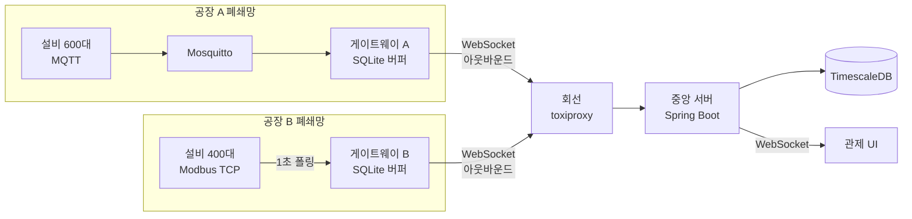

# 폐쇄망 공장 엣지 게이트웨이와 설비 통합 관제 — 설계 문서

> 비전스페이스 채용 과제. 양식의 목차를 유지했다. `TODO`는 구현하면서 채운다.

## 1. 요약
- 무엇을 만들었는가: TODO
- 핵심 설계 결정 3가지
  1. **연결은 게이트웨이가 먼저 여는 WebSocket 하나.** 데이터 업로드와 원격 명령이 같은 연결을 쓴다. 공장망의 "아웃바운드만 허용" 조건을 그대로 만족한다.
  2. **최소 한 번 전달 + 서버 측 중복 제거.** 게이트웨이는 디스크(SQLite)에 먼저 쓰고, 서버가 DB 커밋 후 보낸 ack를 받아야 지운다. 재전송으로 생기는 중복은 서버가 `(device_id, seq)` 유니크 키로 버린다.
  3. **프로토콜이 달라도 중복·순서 기준은 `(device_id, seq)` 하나.** MQTT는 payload의 seq, Modbus는 레지스터의 샘플 카운터를 쓴다.
- 달성한 수치 / 달성하지 못한 것: TODO

## 2. 문제 정의와 가정

### 풀려는 문제
공장 2곳(A: MQTT 600대, B: Modbus TCP 400대)의 설비 1,000대를 중앙에서 실시간으로 관제한다. 공장망은 폐쇄망이라 밖으로 나가는 연결만 허용되고, 회선이 수시로 끊긴다. 회선이 끊겨도 데이터를 잃지 않아야 하고, 정지·재개 명령은 정확히 한 번 적용된 것과 같은 결과를 내야 한다.

### 사용자
관제실 운영자. 공장·설비 상태를 한눈에 보고, 이상이 있는 설비를 원격으로 정지·재개한다. 회선 장애 시에는 어느 공장이 끊겼고 얼마나 쌓였는지를 알아야 한다.

### 직접 세운 가정과 근거
| # | 가정 | 근거 |
|---|---|---|
| 1 | MQTT 설비는 payload에 단조 증가 seq와 측정 시각을 넣는다 | 중복·순서 판단에 설비 쪽 순번이 필요하다. 산업용 MQTT 장비는 보통 시퀀스 번호를 지원한다 |
| 2 | Modbus 설비는 레지스터 0~1번에 32비트 샘플 카운터를 둔다 | Modbus에는 메시지 순번 개념이 없다. PLC 하트비트 카운터는 흔한 설계다. 같은 값을 두 번 읽으면 중복으로 처리된다 |
| 3 | Modbus 측정 시각은 게이트웨이 폴링 시각으로 한다 | 레지스터에 시각이 없다. 오차는 폴링 주기(1초) 이내 |
| 4 | Modbus 설비 400대는 라인 컨트롤러 4대(포트 5020~5023) 아래 unit 1~100으로 붙어 있다 | Modbus unit ID는 247개가 한계라 한 포트에 400대를 둘 수 없다 |
| 5 | 공장 내부망은 물리적으로 분리돼 있어 내부 MQTT 브로커는 인증 없이 둔다 | 과제 범위를 회선·서버 쪽 보안에 집중하기 위해. 운영에서는 TLS + 계정이 필요하다 (12장) |
| 6 | 게이트웨이 토큰은 설치 시 발급돼 장비에 저장돼 있다 | 게이트웨이는 사람이 로그인하지 않는 장비다 |
| 7 | 게이트웨이 디스크 버퍼 상한은 6시간 분량이다 | 공장 A 기준 600대 × 21,600초 ≈ 1,300만 건. 넘으면 가장 오래된 것부터 버리고 유실 건수를 알람으로 올린다 |
| 8 | 서버와 게이트웨이 시계는 NTP로 맞춰져 있다 | 종단 지연 측정은 같은 호스트의 컨테이너끼리 하므로 시계 차이가 없다 |
| 9 | 원격 명령은 정지·재개 두 가지, 운영자 권한이 있어야 실행할 수 있다 | 과제 요구 사항 |
| 10 | 설비의 seq 카운터는 재부팅해도 이어진다 (비휘발) | 0부터 다시 세면 서버가 `(deviceId, seq)` 기준으로 새 데이터를 전부 중복으로 버린다. 에뮬레이터는 시작 시각(epoch 초)을 초기값으로 써서 재현한다 |
| 11 | MQTT 설비는 같은 commandId를 다시 받으면 처음 결과를 그대로 돌려준다 | 재시도가 몇 번 와도 설비에 한 번만 적용되게 하는 마지막 방어선. Modbus는 commandId를 실을 곳이 없어 게이트웨이가 대신 기억한다 (3단계) |
| 12 | 에뮬레이터의 MQTT 설비 600대는 브로커 연결 하나를 공유한다 | 브로커·게이트웨이 입장에서 보이는 토픽·QoS·페이로드는 같다. 연결 600개는 검증 대상(게이트웨이)과 무관한 부하라 뺐다 |

## 3. 요구 사항
| 구분 | 요구 사항 | 목표 수치 | 달성 여부 |
|---|---|---|---|
| 기능 | 설비 1,000대 1초 주기 수집 | 초당 1,000건 | TODO |
| 기능 | 단절 중 로컬 저장, 복구 후 재전송 | 10분 단절 후 유실 0건 | TODO |
| 기능 | 중복 제거, 순서 보정 | 저장 결과 중복 0건 | TODO |
| 기능 | 원격 정지·재개 (응답 확인, 시간 초과, 재시도, 멱등, 감사 로그) | 같은 명령 재시도 시 1회만 적용 | TODO |
| 기능 | 관제 UI (현황, 알람, 명령 결과, 게이트웨이 연결·적체) | — | TODO |
| 비기능 | 종단 지연 (설비 측정 → 화면 전달) | p95 2초 이내 (가정) | TODO |
| 비기능 | 복구 시간 (회선 복구 → 적체 0) | 10분 적체를 2분 안에 소진 (가정) | TODO |

## 4. 전체 아키텍처

### 데이터 흐름
1. 설비 → 게이트웨이: MQTT 구독 또는 Modbus 폴링
2. 게이트웨이: 공통 모델로 정규화 → SQLite outbox에 기록 (이 시점부터 유실 없음)
3. 게이트웨이 → 서버: outbox에서 꺼내 묶음 전송
4. 서버: DB 커밋 (중복은 유니크 키로 무시) → ack → 게이트웨이가 outbox에서 삭제
5. 서버 → UI: 설비 현재 상태가 바뀌면 WebSocket으로 전달

### 명령 흐름
TODO (5단계)

## 5. 구성 요소별 책임
| 구성 요소 | 책임 | 기술 | 선택 이유 |
|---|---|---|---|
| 에뮬레이터 | 설비 1,000대 모사, 중복·순서 뒤바뀜·지연 주입 | Java 25 가상 스레드, Paho, j2mod | 1,000개 동시 실행이 가상 스레드로 간단하다 |
| 게이트웨이 | 수집, 정규화, 디스크 버퍼, 재전송, 명령 중계 | Java 25 (Spring 없음), SQLite | 엣지 장비 자원이 작다고 가정. SQLite는 별도 프로세스 없이 디스크에 안전하게 쓴다 |
| 회선 | 단절·지연 재현 | toxiproxy | 실제 TCP 연결을 끊고 지연시켜 애플리케이션 코드 수정 없이 장애를 만든다 |
| 중앙 서버 | 인증, 중복 제거, 저장, UI 전달, 명령 관리 | Spring Boot 4, 헥사고날 | TODO |
| 저장소 | 시계열 저장 | TimescaleDB | Postgres 그대로라 유니크 키·트랜잭션을 쓸 수 있고 시계열 압축·보관 정책이 있다 |

## 6. 데이터 모델과 메시지 스키마

### 공통 데이터 모델 (`TelemetryRecord`)
| 필드 | 타입 | 설명 |
|---|---|---|
| deviceId | string | `A-0001` ~ `A-0600`, `B-0001` ~ `B-0400` |
| factoryId | string | `A`, `B` |
| protocol | enum | `MQTT`, `MODBUS` |
| seq | long | 설비 단위 단조 증가 순번 |
| deviceTs | long (ms) | 측정 시각 |
| gatewayTs | long (ms) | 게이트웨이 수신 시각 |
| state | enum | `RUNNING`, `STOPPED`, `FAULT` |
| temperature | double | °C |
| vibration | double | mm/s |
| rpm | int | |
| alarmCode | int | 0 = 정상 |

### 프로토콜별 매핑표

**MQTT (공장 A)** — 토픽 `factory/A/device/{deviceId}/telemetry`, QoS 1

| 원본 필드 | 공통 필드 |
|---|---|
| 토픽의 `{deviceId}` | deviceId |
| `seq` | seq |
| `ts` | deviceTs |
| `state` (문자열) | state |
| `temp` | temperature |
| `vib` | vibration |
| `rpm` | rpm |
| `alarm` | alarmCode |

명령: `factory/A/device/{deviceId}/command` 로 발행 → 설비가 `.../command/ack` 로 응답

**Modbus TCP (공장 B)** — 라인 컨트롤러 4대(포트 5020~5023), 포트당 unit 1~100, Holding Register

| 레지스터 | 원본 | 공통 필드 | 변환 |
|---|---|---|---|
| 0~1 | 샘플 카운터 (uint32, 상위·하위) | seq | `(r0 << 16) \| r1` |
| 2 | 상태 코드 | state | 1=RUNNING, 2=STOPPED, 3=FAULT |
| 3 | 온도 × 10 | temperature | ÷ 10 |
| 4 | 진동 × 100 | vibration | ÷ 100 |
| 5 | 회전수 | rpm | 그대로 |
| 6 | 알람 코드 | alarmCode | 그대로 |
| 10 | 제어 (쓰기 전용) | — | 1=RESUME, 2=STOP |
| (없음) | — | deviceTs | 게이트웨이 폴링 시각 (가정 3) |

deviceId 변환: `B-` + `((포트 - 5020) × 100 + unit)` 를 4자리로

인코딩·디코딩 코드는 `common/.../modbus/ModbusRegisterMap.java` 하나를 에뮬레이터(쓰기)와 게이트웨이(읽기)가 함께 쓴다.
온도는 영하를 표현할 수 있게 int16(2의 보수)으로 넣는다.

### 에뮬레이터 장애 주입 (2단계)
| 장애 | 대상 | 방식 | 설정 (환경 변수) |
|---|---|---|---|
| 중복 | MQTT | 같은 메시지를 연달아 두 번 발행 | `FAULT_DUPLICATE_RATE` (기본 1%) |
| 순서 뒤바뀜 | MQTT | 이번 메시지를 붙잡았다가 다음 메시지 뒤에 발행 (seq 5 → 4 순서로 도착) | `FAULT_REORDER_RATE` (기본 1%) |
| 지연 | MQTT | 발행 전 0~N ms 대기. 측정 시각(ts)은 지연 전 값이라 종단 지연에 그대로 반영된다 | `FAULT_DELAY_MAX_MS` (기본 300) |
| 설비 고장 | 공통 | 1초마다 확률적으로 FAULT + 알람 코드(101~103), 10~30초 뒤 자동 복구 | `DEVICE_FAULT_RATE` (기본 0.02%) |
| 중복 읽기 | Modbus | 주입하지 않아도 폴링 특성상 같은 카운터를 두 번 읽으면 생긴다 | — |

Modbus 설비는 게이트웨이가 읽어 가는 구조라 중복·순서 장애를 따로 주입하지 않는다.
알려진 한계: 레지스터 0~6을 하나씩 갱신하므로 게이트웨이가 정확히 그 사이에 읽으면 값 하나가 1초 전 값일 수 있다. 카운터를 마지막에 써서 "새 seq + 옛 값" 조합은 피한다.

### 저장 구조와 보관 정책
TODO (4단계)

## 7. 인터페이스 명세

### 게이트웨이 ↔ 서버 WebSocket (`/ws/gateway`)
프레임: `{"type": "...", "body": {...}}`. 계약은 `common/.../wire/WireMessages.java`에 있다.

| type | 방향 | body | 설명 |
|---|---|---|---|
| BATCH | 게이트웨이 → 서버 | gatewayId, fromOutboxId, toOutboxId, records[] | outbox 묶음 |
| ACK | 서버 → 게이트웨이 | toOutboxId | 해당 번호까지 DB 커밋 완료 (누적) |
| GATEWAY_STATUS | 게이트웨이 → 서버 | bufferedCount, oldestBufferedAgeMs, connectedDevices | 5초마다 |
| COMMAND | 서버 → 게이트웨이 | commandId, deviceId, action, attempt | commandId가 멱등 키 |
| COMMAND_RESULT | 게이트웨이 → 서버 | commandId, outcome, detail | |

순서 보장: 한 게이트웨이의 BATCH는 한 연결에서 순서대로 처리하고 ack도 순서대로 나간다. 연결이 바뀌면 게이트웨이는 마지막 ack 이후부터 다시 보낸다.

### REST API / UI WebSocket / 인증·권한
TODO (4~6단계)

## 8. 장애 시나리오
| 상황 | 감지 방법 | 대응 | 복구 절차 | 검증 방법·결과 |
|---|---|---|---|---|
| 연결 끊김 | TODO | | | |
| 메시지 중복 | | | | |
| 순서 뒤바뀜 | | | | |
| 서버 재시작 | | | | |

## 9. UI 설계
TODO

## 10. 측정 결과
TODO

## 11. 트레이드오프와 대안
| 결정 | 검토한 대안 | 선택 이유 | 감수한 단점 |
|---|---|---|---|
| 게이트웨이 → 서버를 WebSocket으로 | 중앙 MQTT 브로커 (AWS IoT Core 등) | 명령 왕복과 ack를 한 연결에서 직접 다룰 수 있고 구성 요소가 하나 줄어든다 | 게이트웨이 수가 수천 대로 늘면 서버가 연결을 직접 들고 있어야 한다. 그때는 브로커가 낫다 (12장) |
| 디스크 버퍼를 SQLite로 | 파일 append 로그, 임베디드 Kafka | 트랜잭션과 범위 삭제가 기본 제공된다. 장비에 따로 띄울 것이 없다 | 초당 수만 건 이상이면 append 로그가 빠르다. 이 과제는 공장당 초당 600건이다 |
| TODO | | | |

## 12. 한계와 다음 단계
TODO

## 13. AI 활용 내역
TODO

## 14. 실행 방법
README 참고.
